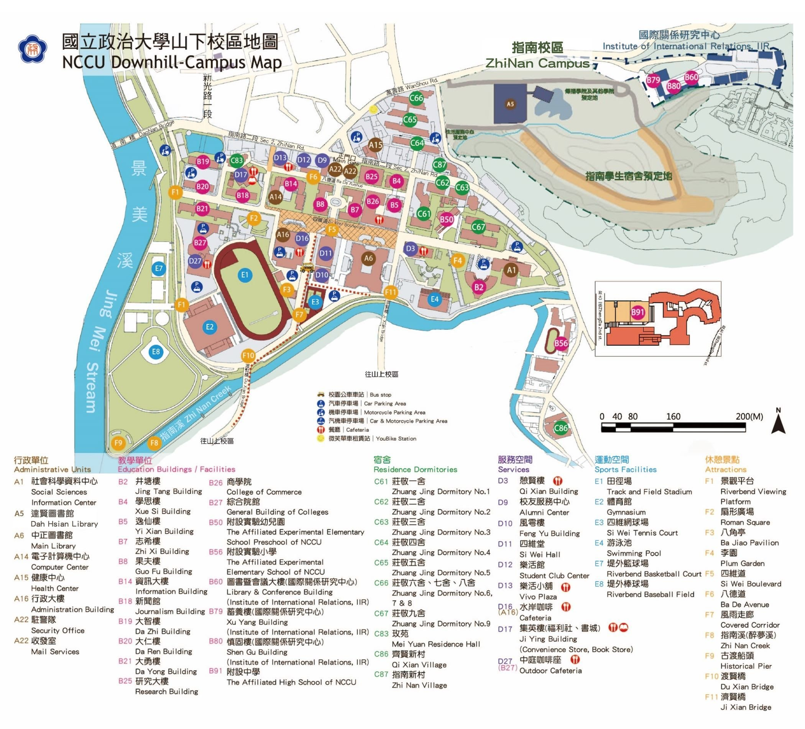

# 參考資料

## 山下校區地圖

`nccu-downhill-campus-map.jpg` 是國立政治大學官方的山下校區地圖，只放在這裡當建模參考，不會用在遊戲畫面裡。

### 地圖方向和遊戲座標的對照

| 地圖上 | 遊戲裡 |
| --- | --- |
| 北（上方，指南路、正門） | z 越大 |
| 南（下方，醉夢溪、往山上校區） | z 越小 |
| 西（左方，景美溪、田徑場） | x 越大 |
| 東（右方，莊敬宿舍、行政大樓以東） | x 越小 |

也就是說，從正門面向四維堂時是朝南走，右手邊是西。

遊戲裡的秘寶地圖和小地圖跟官方地圖同方向：北在上、西在左（v1.31 起；之前東西畫反了）。

### 距離比例

地圖上正門到四維堂大約 135 公尺，遊戲裡是 97 公尺。遊戲的距離大約縮成實際的 0.7 倍，讓走路不會太久。新建築的位置請照「跟已完成建築的相對關係」來放，不要直接用公尺換算。

### 已完成建築在地圖上的代號

| 代號 | 建築 | 遊戲資料夾 |
| --- | --- | --- |
| A22 | 正門、駐警隊 | `main-gate` |
| B25 | 研究大樓 | `research-building` |
| B8 | 果夫樓（四維道西側門字型） | `guofu-hall` |
| B7 | 志希樓（四維道東側門字型） | `zhixi-hall` |
| D11 | 四維堂 | `siwei-hall` |
| A6 | 中正圖書館 | `library` |
| A16 | 行政大樓 | `admin-building` |
| B26 | 商學院 | `business-school` |
| E1 | 田徑場 | `track` |
| E2 | 體育館 | `gym` |
| B27 | 綜合院館 | `zonghe` |
| D3 | 法學院（憩賢樓原址，2025 年啟用） | `law-school` |
| A14、B14 | 電子計算機中心、資訊大樓 | `computer-center` |
| D17 | 集英樓（福利社、書城、餐廳） | `jiying-hall` |
| F5 | 四維道 | 地形（`src/world/terrain/avenue.js`） |

## Google Earth 截圖（道路參考）

`google-earth/` 是 2026 年 10 月的 Google Earth 截圖，用來對照道路網。注意：照片裡田徑場是紅色跑道，那是舊影像，現在已經換成藍色。

照片看到、已經做進遊戲的道路：

| 道路 | 遊戲裡 |
| --- | --- |
| 四維道紅磚段（行政大樓西側到環山一道、法學院） | `SIWEI` 範圍內的紅磚，兩側延伸改成灰色步道 |
| 醉夢溪北岸沿溪道路（體育館南邊到社資中心） | `CREEK_ROAD`，`terrain/creek-road.js` |
| 環山一道往南過濟賢橋上山 | `outer-roads.js`、`river.js` |
| 行政大樓旁車道（校園公車）往南過渡賢橋 | `service-road.js`、`river.js` |
| 四維堂東側車道（圖書館這一側的停車道） | `service-road.js` |
| 電算中心後面的校內道路、往西彎進集英樓前的路、側門廣場 | `back-road.js`（照片在 `back-road/`） |
| 八德道樂活館到電算中心那段（雙黃線、兩側紅磚人行道、花台、樹穴行道樹） | `bade-road.js`（照片在 `computer-center/photos/back-*.jpg`） |
| 八德道西段（學思樓、商學院之間：紅磚人行道、花台、路燈、斑馬線）與商學院八德道後門 | `bade-road.js`、`business-school`；尚無現場照片，沿用東段做法；後門依總務處 2026-09-17 通行公告 |

## 電算中心後面的校內道路（照片）

`back-road/` 是 2026 年 10 月在現場拍的照片，`src/world/terrain/back-road.js` 依照這些照片做。

| 檔案 | 內容 |
| --- | --- |
| `south-from-junction.jpg` | 從北端路口往南看：斑馬線、左轉箭頭、雙黃線、兩側紅磚人行道和花台 |
| `north-toward-gate.jpg` | 往北看：右手邊電算中心的擋土牆、樹籬、白鐵欄杆和「往電算中心」指示牌 |
| `computer-center-railing.jpg` | 同一段的另一個角度，可以看到挑出的白色大樓 |
| `north-planters.jpg` | 往北看：路邊水泥花台、灰色路燈、行道樹 |
| `side-gate-plaza.jpg` | 北端的側門廣場：棋盤格地磚、黃色反光柱、綠色鋼構雨遮店面，出去是指南路 |
| `post-office-building.jpg` | 白色馬賽克磁磚大樓，一樓有郵局（還沒確定是哪一棟，所以遊戲裡還沒做） |

集英樓的照片在 `src/world/buildings/jiying-hall/photos/`。
